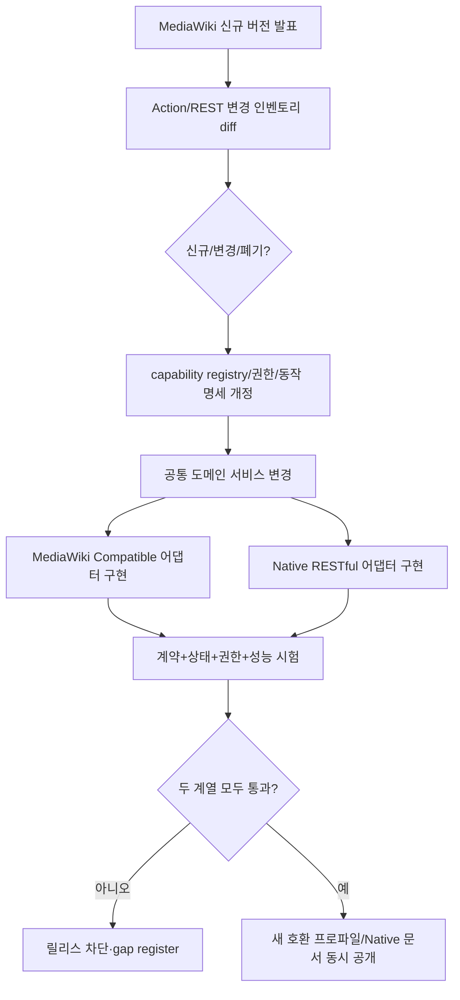

# 14. 공개 API 이중화 설계서 — 버전별 신규 API까지 동시 구현

## 1. 확정 요구사항

**모든 API 기능에는 (A) MediaWiki Compatible API와 (B) Native RESTful API의 공개 접근 경로를 제공해야 합니다.** 다만 MediaWiki 원본에 API route가 존재하지 않는 UI-only 기능에 대해서는 가짜 `api.php`/`rest.php` route를 만들어 원본과 호환된다고 주장하지 않고, Native RESTful API를 제공하여 기능 접근성을 보장합니다. MediaWiki 향후 릴리스에서 **새 API route가 실제 추가되는 경우에는 양 계열에 매핑**합니다. 관리자 정책·기존 MediaWiki 기반 확장 설정에 따라 외부 API의 가용 여부는 차등될 수 있습니다.

| 개념 | 타입·라우트 | 버전 관리 | 규격 |
|---|---|---|---|
| **계열 A: MediaWiki Compatible** | A1. Action API `/{scriptPath}/api.php` (예 `/w/api.php`); A2. MediaWiki REST API `/{scriptPath}/rest.php/*` | MediaWiki 버전별 프로파일: `MW-1.46.2`, 향후 `MW-1.47.x`, ... | 기존 MediaWiki client와 외부 관찰 결과 일치. `rest.php` 경로를 Native로 분류하면 안 됨 |
| **계열 B: Native RESTful** | `/api/v1/*` (향후 breaking change일 때 `/api/v2/*`) | 프로젝트 자체 semantic version, 명시적 deprecation 기간 | OpenAPI 3.1 JSON/HTTP 계약; 도메인 기능별 리소스·명령·조회 제공 |

## 2. 예시 엔드포인트

```http
GET /w/api.php?action=query&prop=revisions&titles=Main_Page&format=json
GET /w/rest.php/v1/page/Main_Page
GET /api/v1/pages/by-title/Main_Page

POST /w/api.php
Content-Type: application/x-www-form-urlencoded

action=edit&title=Sandbox&text=Updated+source&baserevid=123&token=%2B%5C&format=json&formatversion=2

PUT /w/rest.php/v1/page/Sandbox
Content-Type: application/json

{"latest":{"id":123},"source":"Updated source","comment":"","token":"+\\"}

POST /api/v1/pages/{pageId}/revisions
Content-Type: application/json

{"baseRevisionId":"b1c90cc5-0cf7-4815-805c-7f3f7f67f104","source":"Updated source"}

POST /w/api.php?action=upload&filename=Example.png&token=...
POST /api/v1/files/uploads
```

위 요청은 **경로 분리와 기능 mapping을 보여주는 예시**입니다. 원본 MediaWiki REST API의 특정 버전/메서드 전체 목록으로 간주하지 마십시오. 내부 서비스는 외부의 body schema와 분리하고, 실제 등록된 route는 자동 inventory로 검증합니다.

## 3. capability 중심 API 레지스트리

하나의 기능은 여러 기존 API module 또는 여러 Native 리소스 연산으로 나타날 수 있습니다. 따라서 단순 URL 1:1 강제가 아니라 `capability_id`를 중심으로 **다대다 매핑**하고 각 route의 입력·출력 계약을 별도로 테스트합니다.

```yaml
capabilityId: CAP-REVISION-COMMIT
sourceBaseline: MediaWiki-1.46.2
compatible:
  action:
    - method: POST
      path: /w/api.php
      action: edit
  rest:
    - method: PUT
      path: /w/rest.php/v1/page/{title}
native:
  - operationId: commitRevision
    method: POST
    path: /api/v1/pages/{pageId}/revisions
sharedService: PageApplicationService
security:
  policy: read+edit
  auditEvent: revision.committed
tests:
  - contract-action-edit
  - contract-rest-update-page
  - contract-native-commitRevision
  - parity-revision-post-state
status: INCOMPLETE
```

원문 편집의 현재 구현 범위, 기준 revision 및 호환성 차이는 [내부 시험용 원문 편집 계약](15_PAGE_SOURCE_SLICE.md#기존-문서-편집)에 명시합니다.

`CAP-REVISION-HISTORY`와 `CAP-REVISION-READ`의 매핑, 공통 읽기 정책과 차등 검증 기준은 [리비전 이력과 이전 원문 계약](15_PAGE_SOURCE_SLICE.md#리비전-이력과-이전-원문)에 명시합니다.

`CAP-REVISION-COMPARE`의 두 API 계열 매핑과 Wikidiff2 기준 프로파일은 [저장된 리비전 비교 계약](15_PAGE_SOURCE_SLICE.md#저장된-리비전-비교)에 명시합니다.

`CAP-REVISION-UNDO`의 Native와 Action 매핑, 독립 MediaWiki REST 경로의 적용 여부와 부작용은 [후속 편집을 보존하는 단일 편집 취소 계약](15_PAGE_SOURCE_SLICE.md#후속-편집을-보존하는-단일-편집-취소)에 명시합니다.

각 operation의 metadata: `capabilityId`, `upstreamVersionIntroduced`, `upstreamVersionChanged`, `mwCompatAction`, `mwCompatRest`, `nativeOperationIds`, `permissionPolicyId`, `sideEffectIds`, `testIds`, `extensionId`, `status`, `owner`, `fixtureVersion`, `releaseId`.

### API 진화 관리



## 4. 소스와 테스트의 분리

- 입력 검증·기본값·DTO·에러 변환·pagination·응답 헤더는 **어댑터 계층**이 담당합니다.
- ACL, 도메인 객체 로딩, 불변 revision, idempotency, storage transaction, audit, event 발행은 **공통 Application/Domain 계층**에서 담당합니다.
- MediaWiki 경로의 API 토큰·cookie 정책과 Native RESTful bearer 인증은 다르지만 둘 다 동일한 `AccessDecision`으로 수렴해야 합니다.
- API 호출 결과는 wire format이 아니라 도메인 state·event·audit 등 중요한 side effect가 같아야 합니다. 표면별 응답 포맷을 '편의상' 통일하지 않습니다.
- 향후 원본에서 더 이상 지원하지 않는 경로는 **호환 프로파일 정책**에 따라 제공 중단 여부를 결정하며 과거 지원 기준을 조용히 삭제하지 않습니다.

## 5. 테스트/릴리스 차단 규칙

| 게이트 | 검증 내용 | 실패 처리 |
|---|---|---|
| G-API-INVENTORY | 새 버전의 등록된 Action/REST API 변화가 operation registry에 누락 없이 반영됨 | 릴리스 중단 |
| G-COMPAT-CONTRACT | 현존하는 원본 경로의 params/format/cookies/token/rights/errors/status/continuation 일치 | 릴리스 중단 |
| G-NATIVE-CONTRACT | 각 기능에 Native RESTful route·OpenAPI schema·positive/negative tests 존재 | 릴리스 중단 |
| G-STATE-PARITY | 편집/삭제/이동/보호/업로드를 어느 경로에서 수행해도 동일한 불변 revision·이벤트·감사 | 릴리스 중단 |
| G-SEC-PARITY | 익명/로그인/보호/비공개/차단/확장 권한에 대한 동일 허가 판단 | 릴리스 중단 |
| G-UPGRADE-PARITY | 향후 원본에 추가된 endpoint가 호환 route와 Native 기능을 같은 버전에 제공 | 릴리스 중단 |
| G-EXT-API | 기본 번들 및 신규 extension 공개 기능 모두 Native 노출; 원본에 기존 API가 있으면 호환 adapter | 릴리스 중단 |

테스트 리포트는 외부 CI artifact 또는 저장소 밖의 임시 경로에 machine-readable 형식으로 출력하고 누락 수, 차이 유형, 테스트 구성, 실행시간 및 reference checksum을 기록합니다. Git에는 시험 소스·fixture·합격 기준만 보관하고 실행 리포트는 추가하지 않습니다.

## 6. 설계 범위에 관한 주의

`specs/openapi.yaml`은 **Native RESTful의 대표 endpoint 초안**입니다. 전체 기능을 포괄하지 않으므로 GA 완료로 주장할 수 없습니다. `specs/api_operation_registry.csv`도 초기 기능 매핑 예시이며, 실제 기준 버전의 전수 API 인벤토리 추출·확인은 개발 트랙 T0에서 수행합니다. 본 문서에서 아직 작성되지 않은 모든 API는 **누락이 아닌 구현 예정 요구사항**으로 추적되고, 제품 GA는 전수 검사 통과 전까지 불가능합니다.

## 7. 1.0 교차 검증 범위와 미완성 계약

새 실행환경·DB 정책은 공개 route를 자동 추가하지 않습니다. 모든 기존 operation에 공통 적용되는 실행 조건으로 코어와 모든 확장의 네 DBMS·두 앱 CPU·LOCAL/S3 matrix에서 기능·ACL·state/audit parity를 시험합니다. 이는 외부 서비스의 CPU/OS를 앱에 맞추는 요구가 아닙니다. 각 버전/에디션/패치와 설정은 시험 manifest에 기록합니다.

현재 registry와 OpenAPI는 설계 예시이며 관리 작업의 전수 목록이 아닙니다. 확장 제거/영구 삭제·계정 재설정/복구·토큰 폐기/MFA 재등록 등의 전체 관리 operation 상세화, 원본 API 존재 확인, Native schema/오류/권한/부작용 및 테스트 연결이 남아 있습니다. UI_ONLY·NOT_APPLICABLE은 관찰 근거와 이유가 있을 때만 사용하며 미확인을 대체하지 않습니다.
